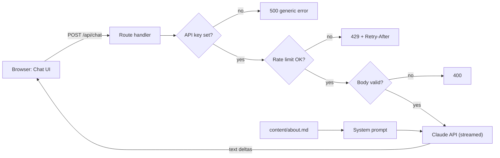

# Resume Chatbot

A public chat assistant that answers recruiter questions about Harsh's experience, projects and skills. It answers only from a single CV file (`content/about.md`) that is placed in the system prompt. There is no vector database, by design: the corpus is a few thousand tokens.

**Live demo:** TODO(Harsh): add the live demo URL after the first Vercel deploy.

## Architecture



Checks run in this order (`src/app/api/chat/route.ts`): API key present, per-IP rate limit, body validation, then the Claude call. Invalid or rate-limited requests never reach the Claude API.

| Limit                        | Value                                    | Where                       |
| ---------------------------- | ---------------------------------------- | --------------------------- |
| Requests per IP              | 10 per minute                            | `src/app/api/chat/route.ts` |
| Messages per request         | 20                                       | `src/lib/validate.ts`       |
| User message length          | 1000 characters                          | `src/lib/validate.ts`       |
| Assistant message length     | 4000 characters                          | `src/lib/validate.ts`       |
| Total characters per request | 20000                                    | `src/lib/validate.ts`       |
| Reply length                 | `max_tokens` 600                         | `src/app/api/chat/route.ts` |
| Model                        | `CHAT_MODEL`, default `claude-haiku-5-5` | `src/app/api/chat/route.ts` |

## Design decisions

- **Whole CV in the system prompt, no retrieval.** Fewer moving parts and no retrieval failure modes. If the corpus outgrows the prompt, move to RAG.
- **Anthropic SDK directly**, streamed to the browser as plain text, with no UI framework for chat.
- **Stateless server.** The client sends the history on each request, trimmed to the server limits.
- **In-memory rate limiter.** Serverless instances do not share memory, so it is best-effort. The real backstop is a spend limit set in the Anthropic console.

## Getting started

Prerequisites: Node.js 22.18 or later and an Anthropic API key.

```bash
npm install
cp .env.example .env.local   # then set ANTHROPIC_API_KEY
npm run dev
```

Replace the placeholder CV in `content/about.md`. Every `TODO(Harsh)` marker must be replaced with real content. The assistant knows only what is in this file.

## Scripts

| Script              | What it does                                                                                       |
| ------------------- | -------------------------------------------------------------------------------------------------- |
| `npm run dev`       | Start the dev server                                                                               |
| `npm run build`     | Production build                                                                                   |
| `npm start`         | Serve the production build                                                                         |
| `npm run lint`      | ESLint                                                                                             |
| `npm test`          | Unit and component tests (Anthropic client mocked, no key needed)                                  |
| `npm run eval`      | Run the eval suite against a live endpoint (needs a key and a running server)                      |
| `npm run check:key` | Build with a dummy key and fail if the key name or value appears in client assets (`.next/static`) |

## Evals

`npm run eval` runs 15 cases against `/api/chat`: grounded questions, hallucination traps (fake employer, degree, award, project) and prompt-injection attempts. A full run takes about 2 minutes because of the rate limit. See [evals/README.md](evals/README.md). The grounded cases are loose while the CV is a placeholder; tighten them once the real CV is in.

## Mobile check (375px)

Open the app in browser devtools with the device toolbar at 375px width. Expected: no horizontal scroll, messages wrap, and the input and Send button fit on one row. The input uses a 16px font so iOS does not zoom on focus.

## Deploying to Vercel

1. Push the repository to GitHub (or another Git host Vercel supports).
2. Import the project in Vercel (framework preset: Next.js, default build settings).
3. Under Project Settings, Environment Variables, set `ANTHROPIC_API_KEY` for Production and Preview. Optionally set `CHAT_MODEL`.
4. Deploy, then paste the URL into the demo line at the top of this file.

`content/about.md` is read with `process.cwd()` at runtime. After `npm run build`, `.next/server/app/api/chat/route.js.nft.json` lists it, so Vercel's file tracing bundles it with the route.

## Before going public

These steps need a human and were not done by the automated build:

- Set a hard spend limit in the Anthropic console.
- Replace the placeholder CV in `content/about.md` with real content.
- Run `npm run eval` against the real model, read any failures, and update the grounded cases.
- Deploy and add the live demo URL above.

## Security notes

- The API key is read only in the server route from `ANTHROPIC_API_KEY`. It is never prefixed `NEXT_PUBLIC_`, never returned in a response and never logged. `npm run check:key` guards the client bundle.
- Misconfiguration returns a generic 500 with no details.
- The system prompt scopes the assistant to the CV and tells it to ignore instruction changes. The eval suite includes injection cases. The prompt contains only public CV content.
